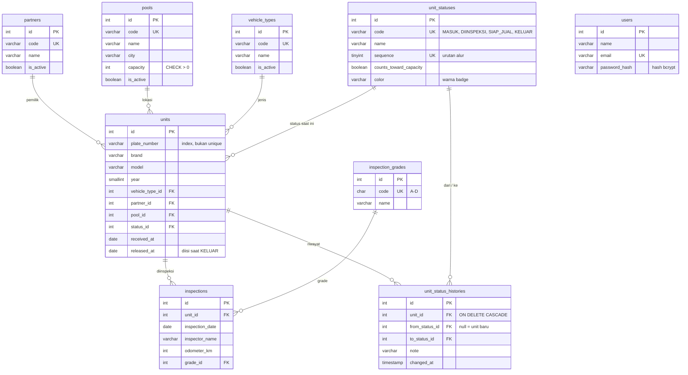

# PoolTrack — Sistem Manajemen Unit Aset di Pool

Dashboard internal untuk mencatat unit kendaraan (hasil penarikan dari mitra leasing) yang disimpan di beberapa
**pool**, mulai dari unit masuk, diinspeksi, siap diserahkan ke kanal penjualan, sampai keluar.
Dibuat sebagai *technical challenge* CRUD dashboard dengan frontend dan backend terpisah.

> Studi kasus ini fiktif dan disederhanakan untuk keperluan technical challenge. Alur bisnis sebenarnya di industri
> pengelolaan aset tentu jauh lebih kompleks.

---

## Daftar isi

- [Latar belakang](#latar-belakang)
- [Fitur](#fitur)
- [Tech stack](#tech-stack)
- [Arsitektur](#arsitektur)
- [Database (ERD)](#database-erd)
- [Aturan bisnis](#aturan-bisnis)
- [Login & keamanan](#login--keamanan)
- [Menjalankan di lokal](#menjalankan-di-lokal)
- [Environment variables](#environment-variables)
- [Dokumentasi API](#dokumentasi-api)
- [Data contoh & skenario demo](#data-contoh--skenario-demo)
- [Deploy](#deploy)
- [Dokumen lain](#dokumen-lain)

---

## Latar belakang

**PT Arta Aset Nusantara** (fiktif) menerima unit kendaraan dari beberapa mitra leasing dan menyimpannya di 4 pool
(Tangerang, Bekasi, Bandung, Surabaya). Pencatatan masih memakai Excel per pool yang dikirim lewat WhatsApp, sehingga:

| Masalah | Jawaban PoolTrack |
|---|---|
| Data tidak sinkron, satu unit pernah tercatat di dua pool | Satu database terpusat; satu unit hanya punya satu `pool_id` |
| Pool kelebihan kapasitas, padahal pool lain kosong | Validasi kapasitas saat unit masuk/pindah, okupansi terlihat di dashboard |
| Hasil inspeksi tercecer di kertas/chat | Tabel `inspections` yang terhubung ke unit |
| Mitra sering menanyakan status unit | Pencarian plat + timeline riwayat status |
| Rekap mingguan butuh 1–2 hari | Dashboard dihitung otomatis dari database |

Alur status unit:

```
MASUK → DIINSPEKSI → SIAP JUAL → KELUAR          (+ pindah pool kapan saja selama unit aktif)
```

Detail lengkap: [docs/01-studi-kasus.md](docs/01-studi-kasus.md) dan [docs/02-workflow-database.md](docs/02-workflow-database.md).

## Fitur

- **Dashboard**: jumlah unit per status, okupansi tiap pool, grafik unit aktif per mitra, 5 inspeksi terbaru.
- **Unit**: daftar dengan pencarian (plat/merek/model) dan filter (status, pool, mitra, jenis), tambah/ubah/hapus,
  halaman detail dengan timeline riwayat, tombol ubah status, pindah pool, dan tambah inspeksi.
- **Inspeksi**: hasil inspeksi per unit (tanggal, inspektor, odometer, kondisi eksterior/interior/mesin, grade A–D).
- **Master data**: CRUD Mitra, Pool (dengan kapasitas & okupansi), Jenis Kendaraan; master bisa dinonaktifkan.
- **Login & register** sederhana (JWT): semua halaman dan API data hanya bisa diakses setelah login.
- **UX**: skeleton loading, empty & error state, toast, dialog konfirmasi, error validasi per field (termasuk dari
  server), responsif sampai lebar ponsel.

## Tech stack

| Bagian | Teknologi |
|---|---|
| Database | MariaDB 11.4 |
| Backend | Node.js 20+, Express 5 (ES Modules), Knex + `mysql2`, Zod, `jsonwebtoken` + `bcryptjs` (auth) |
| Frontend | React 19 + TypeScript, Vite, Tailwind CSS v4, shadcn/ui, lucide-react |
| Data & form | TanStack Query, axios, React Hook Form + Zod |
| Lainnya | React Router 7, Recharts, sonner |

## Arsitektur

```
pooltrack/
├── docker-compose.yml        # MariaDB untuk development
├── docs/                     # studi kasus, workflow & database
├── backend/
│   ├── knexfile.js           # konfigurasi Knex (app + CLI migrate/seed)
│   ├── requests.http         # koleksi request API (VS Code REST Client)
│   └── src/
│       ├── config/           # baca & validasi env (gagal start jika env salah), koneksi DB
│       ├── constants/        # kode status, pagination, pesan — satu tempat
│       ├── database/         # migrations, seeds, data contoh
│       ├── middlewares/      # validate (Zod), requireAuth (cek token), errorHandler, notFound
│       ├── modules/<fitur>/  # *.routes → *.controller → *.service → *.repository (+ *.schema)
│       └── utils/            # AppError, response helper, pagination, helper validasi
└── frontend/
    └── src/
        ├── app/              # router, providers, layout (sidebar + header)
        ├── components/       # komponen bersama: DataTable, FormDialog, StatusBadge, …
        ├── config/           # menu & route (satu sumber), konstanta UI
        ├── features/<fitur>/ # types, api, hooks (TanStack Query), schema (Zod), components, pages
        └── lib/              # axios instance, helper API/form/format
```

**Backend berlapis** — setiap lapisan punya satu tanggung jawab:

| Lapisan | Tugas |
|---|---|
| `routes` | Menentukan URL + middleware validasi |
| `controller` | Hanya mengurus request/response |
| `service` | **Semua aturan bisnis** dan transaction |
| `repository` | Hanya query Knex ke database |

**Tanpa hardcode**: kredensial/URL dari `.env`; status, grade, dan master dari database (diisi seeder); label & warna
badge status dari tabel `unit_statuses`; kode status hanya ada di `backend/src/constants/unitStatus.js`. Frontend
tidak menyimpan aturan bisnis — setiap unit dari API membawa `actions` (aksi apa yang diizinkan) yang dihitung backend.

## Database (ERD)



Semua foreign key `ON DELETE RESTRICT` (master yang dipakai tidak bisa dihapus), kecuali riwayat status yang ikut
terhapus bersama unitnya. Tabel `users` berdiri sendiri (dipakai untuk login). Detail kolom: [docs/02-workflow-database.md](docs/02-workflow-database.md#3-detail-tabel).

## Aturan bisnis

| # | Aturan | Implementasi (`backend/src/modules/…`) |
|---|---|---|
| 1 | Plat unik di antara unit **aktif** | `units/unit.service.js` → `assertPlateAvailable` (bukan UNIQUE index: unit yang sudah keluar boleh masuk lagi) |
| 2 | Tidak bisa masuk/pindah ke pool penuh | `assertPoolHasSpace`: **transaction + `SELECT … FOR UPDATE`** pada baris pool |
| 3 | Status hanya maju 1 langkah | `target.sequence === current.sequence + 1` (kolom `sequence`, bukan kode) |
| 4 | Inspeksi pertama: MASUK → DIINSPEKSI | `inspections/inspection.service.js` → insert inspeksi + ubah status + riwayat dalam 1 transaction |
| 5 | SIAP JUAL wajib minimal 1 inspeksi | `getNextStepBlockedReason` |
| 6 | KELUAR mengisi `released_at`, tidak dihitung kapasitas | `changeStatus` + flag `counts_toward_capacity` |
| 7 | Master yang dipakai tidak bisa dihapus | Cek di service (pesan jelas) + FK `RESTRICT` sebagai pengaman |
| 8 | Unit hanya bisa dihapus saat MASUK | `units/unit.service.js` → `remove` |
| 9 | Setiap perubahan status tercatat | Tabel `unit_status_histories` |

Keputusan tambahan (A–K), misalnya unit KELUAR menjadi arsip dan kapasitas pool tidak boleh diturunkan di bawah
okupansi, tercatat di [docs/02-workflow-database.md](docs/02-workflow-database.md#keputusan-tambahan-disepakati-16-okt-2026).

**Uji konkurensi:** 3 request bersamaan ke pool yang sisa 1 slot menghasilkan tepat 1 sukses (201) dan 2 ditolak (409).

## Login & keamanan

Login sederhana berbasis **JWT**. Semua pengguna punya akses yang sama (multi-role di luar scope).

```
Login / register ─▶ backend cek email & password (bcrypt) ─▶ kirim token JWT (berlaku JWT_EXPIRES_IN)
Frontend simpan token di localStorage ─▶ setiap request: header  Authorization: Bearer <token>
Middleware requireAuth ─▶ token valid? lanjut : 401 ─▶ frontend otomatis kembali ke halaman login
```

| Topik | Keputusan |
|---|---|
| Endpoint terbuka | `GET /health`, `POST /auth/register`, `POST /auth/login`. Semua endpoint lain wajib token |
| Password | Disimpan sebagai **hash bcrypt**, tidak pernah dikirim balik ke klien |
| Pesan login gagal | Selalu "Email atau password salah", supaya tidak membocorkan email mana yang terdaftar |
| Email | Disimpan huruf kecil; `Admin@X.com` dan `admin@x.com` dianggap sama |
| Penyimpanan token | `localStorage`: sederhana dan cocok untuk frontend–backend beda domain. *Trade-off:* rentan dicuri bila ada celah XSS; alternatif yang lebih aman adalah cookie `httpOnly` |
| Register | Terbuka untuk siapa saja; setelah register pengguna langsung masuk |

**Akun demo** (dibuat oleh `npm run seed`, fiktif — ganti/hapus untuk production):

| Email | Password |
|---|---|
| `admin@pooltrack.example` | `pooltrack123` |

## Menjalankan di lokal

### Prasyarat

- Node.js **20+**
- MariaDB 10.5+ — lewat Docker (`docker-compose.yml`) **atau** instalasi MariaDB biasa

### 1. Database

> **Tentang Docker:** `docker-compose.yml` hanya menyediakan MariaDB untuk development. Backend dan frontend dijalankan
> langsung dengan Node.js (di lokal) dan di-deploy dari kode sumber ke Render & Vercel, sehingga tidak memerlukan
> Docker.

**Pilihan A — Docker:**

```bash
cp .env.example .env              # Windows: copy .env.example .env
docker compose up -d db
```

**Pilihan B — MariaDB yang sudah terpasang:** buat database dan user sesuai nilai `DB_*` di `backend/.env`:

```sql
CREATE DATABASE pooltrack CHARACTER SET utf8mb4 COLLATE utf8mb4_unicode_ci;
CREATE USER 'pooltrack'@'localhost' IDENTIFIED BY 'pooltrack_secret';
CREATE USER 'pooltrack'@'127.0.0.1' IDENTIFIED BY 'pooltrack_secret';
GRANT ALL PRIVILEGES ON pooltrack.* TO 'pooltrack'@'localhost';
GRANT ALL PRIVILEGES ON pooltrack.* TO 'pooltrack'@'127.0.0.1';
```

### 2. Backend

```bash
cd backend
cp .env.example .env              # sesuaikan DB_* bila perlu
npm install
npm run migrate                   # buat semua tabel
npm run seed                      # isi data referensi, master, dan 32 unit contoh
npm run dev                       # http://localhost:4000/api
```

### 3. Frontend (terminal terpisah)

```bash
cd frontend
cp .env.example .env
npm install
npm run dev                       # http://localhost:5173
```

### Script npm

| Folder | Perintah | Fungsi |
|---|---|---|
| backend | `npm run dev` | Jalankan API dengan auto-restart |
| backend | `npm start` | Jalankan API (production) |
| backend | `npm run migrate` | Jalankan migration yang belum dijalankan |
| backend | `npm run migrate:rollback` | Batalkan semua migration |
| backend | `npm run seed` | Kosongkan tabel lalu isi data contoh |
| backend | `npm run db:reset` | Rollback + migrate + seed (kembali ke data awal) |
| frontend | `npm run dev` | Server development Vite |
| frontend | `npm run build` | Type-check + build production ke `dist/` |
| frontend | `npm run lint` | Lint dengan oxlint |

## Environment variables

Setiap folder punya `.env.example`. Aplikasi **langsung berhenti dengan pesan jelas** jika ada variabel yang kurang
atau salah format.

**`backend/.env`**

| Variabel | Contoh | Keterangan |
|---|---|---|
| `NODE_ENV` | `development` | `development` / `production` / `test` |
| `PORT` | `4000` | Port API |
| `CORS_ORIGIN` | `http://localhost:5173` | Origin frontend; pisahkan dengan koma jika lebih dari satu |
| `DB_HOST` | `127.0.0.1` | Host MariaDB |
| `DB_PORT` | `3306` | Port MariaDB |
| `DB_USER` | `pooltrack` | User database |
| `DB_PASSWORD` | `pooltrack_secret` | Password database |
| `DB_NAME` | `pooltrack` | Nama database |
| `DB_TIMEZONE` | `+07:00` | Zona waktu sesi database (WIB) agar `created_at` / riwayat sama di semua server |
| `DB_SSL` | `false` | `true` untuk database cloud yang mewajibkan koneksi SSL (mis. Aiven) |
| `DB_SSL_CA` | *(kosong)* | Isi sertifikat CA (PEM) dari penyedia database; wajib jika `DB_SSL=true` |
| `JWT_SECRET` | *(string acak ≥ 32 karakter)* | Kunci rahasia penanda tangan token login. Buat dengan `node -e "console.log(require('crypto').randomBytes(48).toString('hex'))"` |
| `JWT_EXPIRES_IN` | `8h` | Masa berlaku token login (`8h` = 8 jam, `1d` = 1 hari) |

**`frontend/.env`**

| Variabel | Contoh | Keterangan |
|---|---|---|
| `VITE_API_URL` | `http://localhost:4000/api` | URL backend, termasuk `/api` |
| `VITE_APP_NAME` | `PoolTrack` | Nama aplikasi di sidebar & judul tab |

**`.env` (root, untuk `docker compose`)**: `DB_ROOT_PASSWORD`, `DB_NAME`, `DB_USER`, `DB_PASSWORD`, `DB_PORT` —
nilainya harus sama dengan `backend/.env`.

## Dokumentasi API

Base URL: `http://localhost:4000/api`. Semua request bisa langsung dicoba lewat
[`backend/requests.http`](backend/requests.http) (ekstensi VS Code *REST Client*) — jalankan request **Login** dulu,
token-nya otomatis dipakai request lain.

Selain `/health` dan `/auth/register|login`, setiap request wajib membawa header `Authorization: Bearer <token>`.

### Format response

```jsonc
// sukses (meta hanya ada di endpoint list)
{ "success": true, "message": "Daftar unit berhasil dimuat", "data": [ … ],
  "meta": { "page": 1, "limit": 10, "total": 32, "totalPages": 4 } }

// gagal
{ "success": false, "message": "Data yang dikirim tidak valid",
  "errors": [{ "field": "plate_number", "message": "Format nomor plat tidak valid, contoh: B 1234 XYZ" }] }
```

| Status | Arti |
|---|---|
| `200` / `201` | Berhasil / data dibuat |
| `400` | Validasi input gagal (detail per field di `errors`) |
| `401` | Belum login, token tidak valid/kedaluwarsa, atau email/password salah |
| `404` | Data atau endpoint tidak ditemukan |
| `409` | Konflik aturan bisnis: pool penuh, plat aktif ganda, urutan status, master masih dipakai, unit arsip |
| `500` | Kesalahan server |

### Query list

Semua endpoint list menerima `page`, `limit` (maks. 100), `search`, `sort`, `order` (`asc`/`desc`), ditambah filter
spesifik. Nilai `sort` dibatasi daftar kolom yang diizinkan (whitelist).

### Endpoint

| Method | Endpoint | Keterangan |
|---|---|---|
| GET | `/health` | Status API + koneksi database *(terbuka)* |
| POST | `/auth/register` | Body `{ name, email, password }` → `{ user, token }` *(terbuka)* |
| POST | `/auth/login` | Body `{ email, password }` → `{ user, token }` *(terbuka)* |
| GET | `/auth/me` | Data pengguna yang sedang login |
| GET | `/references/unit-statuses` | Status unit (label, urutan, warna, flag kapasitas) |
| GET | `/references/inspection-grades` | Grade inspeksi A–D |
| GET, POST | `/partners` | Daftar / tambah mitra. Filter: `is_active` |
| GET, PUT, DELETE | `/partners/:id` | Detail / ubah / hapus mitra |
| GET, POST | `/pools` | Daftar (termasuk `occupied` & `capacity`) / tambah pool. Filter: `is_active` |
| GET, PUT, DELETE | `/pools/:id` | Detail / ubah / hapus pool |
| GET, POST | `/vehicle-types` | Daftar / tambah jenis kendaraan. Filter: `is_active` |
| GET, PUT, DELETE | `/vehicle-types/:id` | Detail / ubah / hapus jenis kendaraan |
| GET | `/units` | Daftar unit. Filter: `status_id`, `pool_id`, `partner_id`, `vehicle_type_id` |
| POST | `/units` | Unit masuk (status otomatis MASUK) |
| GET, PUT | `/units/:id` | Detail (+ `actions`) / ubah data unit (pool & status tidak lewat sini) |
| DELETE | `/units/:id` | Hapus — hanya unit MASUK tanpa inspeksi |
| PATCH | `/units/:id/status` | Body `{ to_status_id, note? }` — maju satu langkah |
| PATCH | `/units/:id/move` | Body `{ pool_id, note? }` — pindah pool |
| GET | `/units/:id/histories` | Timeline riwayat status |
| GET, POST | `/units/:id/inspections` | Inspeksi milik unit / tambah inspeksi |
| GET | `/inspections` | Semua inspeksi. Filter: `grade_id`, `pool_id`, `unit_id` |
| GET, PUT, DELETE | `/inspections/:id` | Detail / ubah / hapus inspeksi |
| GET | `/dashboard/summary` | Ringkasan dashboard |

Contoh unit dari API (dipotong):

```json
{
  "id": 33,
  "plate_number": "B 1234 XYZ",
  "status": { "id": 1, "code": "MASUK", "name": "Masuk", "color": "#2563EB", "sequence": 1 },
  "pool": { "id": 1, "code": "TGR", "name": "Pool Tangerang" },
  "inspection_count": 0,
  "actions": {
    "next_status": { "id": 2, "name": "Diinspeksi", "color": "#D97706" },
    "can_change_status": false,
    "change_status_blocked_reason": "Status Diinspeksi diberikan otomatis saat hasil inspeksi pertama disimpan. …",
    "can_edit": true, "can_move": true, "can_inspect": true, "can_delete": true
  }
}
```

## Data contoh & skenario demo

`npm run seed` mengisi data **fiktif**: 4 status, 4 grade, 5 mitra (1 nonaktif), 4 pool, 3 jenis kendaraan,
32 unit lengkap dengan 26 inspeksi serta riwayatnya, dan 1 [akun demo](#login--keamanan). Tanggal ditulis relatif
terhadap hari seed dijalankan.

- **Pool Tangerang terisi 11/12** — tambah 1 unit masih bisa, unit berikutnya ditolak karena penuh.
- `D 4521 KJ` pernah KELUAR lalu masuk lagi (contoh plat ganda yang sah).
- `B 5507 GHA` diinspeksi dua kali (grade C, lalu B setelah perbaikan).

Skenario demo (`B 1234 XYZ` sengaja tidak ada di seed):

0. **Login** dengan akun demo (atau daftar akun baru di halaman Register).
1. **Unit Masuk** `b1234xyz` ke Pool Tangerang → tersimpan sebagai `B 1234 XYZ`, Tangerang menjadi 12/12.
2. Coba tambah unit lain ke Tangerang → **ditolak 409** "Kapasitas Pool Tangerang penuh (12/12)".
3. Buka detail unit → **Tambah Inspeksi** → status otomatis **Diinspeksi**.
4. **Tandai Siap Jual** → **Pindah Pool** (opsional) → **Tandai Keluar**.
5. Lihat timeline riwayat dan dashboard yang ikut berubah.

Kembalikan data ke kondisi awal dengan `npm run db:reset`.

## Deploy

Rencana: **frontend → Vercel**, **backend → Render**, **database → Aiven for MySQL**.

Di lokal database memakai MariaDB; di cloud memakai MySQL 8 karena kompatibel penuh dengan driver `mysql2` dan
query yang dipakai. Koneksi backend ↔ database cloud dienkripsi dengan SSL (`DB_SSL=true` + `DB_SSL_CA`).

## Dokumen lain

- [docs/01-studi-kasus.md](docs/01-studi-kasus.md) — latar belakang, masalah, ruang lingkup
- [docs/02-workflow-database.md](docs/02-workflow-database.md) — workflow, detail tabel, aturan bisnis, keputusan desain
- [backend/requests.http](backend/requests.http) — koleksi request API

---

> Studi kasus ini fiktif dan disederhanakan untuk keperluan technical challenge. Alur bisnis sebenarnya di industri
> pengelolaan aset tentu jauh lebih kompleks. Semua nama perusahaan, mitra, dan data unit adalah fiktif.
